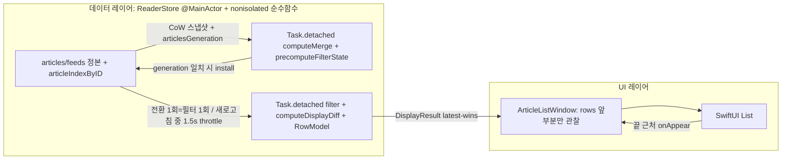
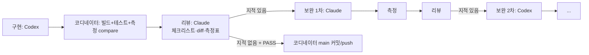

# macOS 대량 글 목록 렉 제거 계획 (실측 검증 · 회귀 체크리스트 · Orca orchestration)

## Context
수천 개 글 라이브러리에서 macOS 앱 메인 스레드가 멈춤: (1) 탭/소스 전환(일부 피드 → "모든 글" 5초+), (2) 새로고침, 그리고 스크롤 중 렉 여부도 확인 필요. 목표는 **어떤 경우에도 화면이 멈추지 않는 것** — 데이터 레이어가 off-main에서 결과를 완성하고, UI는 큐처럼 필요한 만큼만 받아 매끄럽게 노출. 개선은 **실측 수치로 before/after 증명**하고, 과거 수정 이력에서 뽑은 **회귀 체크리스트**로 게이트한다.

분석 근거: ultracode 워크플로 2회(분석 4·설계 2·비판 1 / 히스토리 마이닝 6·측정 설계 1·통합 1·비판 1). 101개 원시 회귀 항목 → 71개 체크리스트.

### 근본 원인 (코드 대조 완료)
- **전환**: 필터·정렬은 이미 off-main. 정지 본체는 `applyDisplayed`의 `displayedArticles = result`(ReaderStore.swift:972)가 50→5,000행을 한 트랜잭션에 `List`(ContentView.swift:1536)로 넘기는 것 — `ForEach` 클로저가 패스마다 전체 행 실행(250a6a3: 650 body vs 8,865 closure ≈ 20패스) + 신규 행 노드 생성 + NSTableView 삽입. 전환 1회에 필터 2~4회 예약(`selectSmartSource` 1070-1076, `feedSelection` didSet 91, `clearRetainedArticles` 3864), 바깥 cancel이 detached 정렬에 전파 안 됨(874-880).
- **새로고침**: 400ms flush(4897)마다 메인 O(N) 6~8패스(merge 사전 재구성 + `articles` didSet). `existingArticlesByID[id] != article`(4821)가 body·`hasExplicitPublishDate`까지 비교해 새 글 0개여도 changed → 체인 매번 실행. 사이드바가 피드별 begin/end(~600회)·favicon·token 변경마다 전체 재평가.
- **공통 증폭**: 루트 뷰가 `selectedArticle`(786, `articles.first` O(N))을 여러 번 읽음 / 사이드바 `count(for: .all)`가 `articles.count` 관찰(2395) / 읽음 토글이 `updateDisplayedArticleInPlace`(3939)로 전체 목록 재게시 / `ArticleListView` body가 `offlineDownloadProgress`·selection 의존 / AI 분류 25개마다 전체 대입(2083) / `markVisibleArticlesSeen` 글별 HLC.
- **스크롤**: macOS는 `ListTitleTranslator.setScrolling`을 안 불러(iOS만 RootView.swift:3013) 스크롤 중 번역 시작 → `MacListRowHeightInvalidator`가 `noteHeightOfRows` + 동기 `layoutSubtreeIfNeeded`(ExpandReveal.swift:136-139). e41d177의 미귀속 stall 720s(입력 phase) 후보.

## 결정 사항 (사용자 확정)
- 윈도 큐 먼저, 실측(C 스크롤 기준·스크롤바 UX) 후 Phase 5 NSTableView 여부 판단.
- macOS만 개선. iOS는 회귀 없음 보장 + **같은 방식 적용 시 기대 이득 비교 리포트**.
- Orca orchestration: 구현 Codex → 리뷰 Claude → 보완 1차 Claude, 2차 Codex, 3차 Claude… 교대 반복.

## 목표 구조

별도 actor 엔진은 정본 이중화(CRDT 위험) 때문에 도입하지 않음.

---

## Phase 0 — 측정 인프라 + 기준선 (DEBUG 전용, 제품 동작 불변)
1. **MainThreadLog 확장** (`NookKit/Sources/NookKit/MainThreadLog.swift`): `scenarioBegin/End`(카운터·stall·프레임 diff를 `scenario.stats` 한 줄로), `run.begin label= sha= lib= hz= log=`, `-NookStallMs 50`(heartbeat 8ms, ≥50/100/250/500/1000 버킷), displayLink 기반 히치 측정(목록 안 0크기 `NSViewRepresentable`, `hitchRatio` ms/s·`p99Frame`·`worstFrame`), `OSSignposter` interval 병행.
2. **ms scope·카운터**: `store.applyDisplayed`, `bg.filter`, `store.merge`/`merge.flush`/`merge.changedNoNew`/`merge.fallback`, `store.didset.articles`, `store.markSeen`/`hlc.tick`, `store.updateInPlace`, `select.begin`→`list.settled`(TTFR), `list.window.grow`, `list.title.box`, `list.row.height.flush`, `root.body`, `sidebar.body`, `sidebar.row`, `reader.body`. 기존 카운터(list.body/rowcontent/row/publish, list.row.menu/swipe, relativetime.body) 의미 유지.
3. **결정적 대형 라이브러리**: `NookKit/Tests/NookKitTests/PerfLibraryGenerator.swift`(env 없으면 skip, 실제 모델+`ReaderStorage.save`/shard 사용, SplitMix64 seed 42) → `lib-5k/10k/20k`(300피드 Zipf, `feed-small` 30개, 12폴더, 8카테고리, unread 60%, starred 2%, 기준일 고정, favicon 캐시 포함). 피드 XML 변형 `none/trickle/burst/big1` + `tools/perf/feedserver.py`(127.0.0.1:8765, 결정적 지연 50~800ms).
4. **앱 연결 launch arg**: `-NookPerfLibrary <dir>`(bookmark·UserDefaults에 **쓰지 않음** → 실 iCloud 라이브러리 보호), `-autoRefreshEnabled NO`, `-NookFaviconFetch NO`, `-NookAICategorize NO`, `-NookFakeTranslator <ms>`, `-NookFreezeRelativeTime`. 로드 후 `perf.library articles= unread= …` 검증 줄.
5. **스크립트 드라이버** `Nook/PerfDriver.swift`(`#if DEBUG`): `-NookPerfScript <json>`, 단계마다 settle → begin → 동작 → quiesce → end, 5회 반복 + cold 1회, 창 1440×900 고정, 공개 API는 어댑터 한 겹으로 호출. 실제 휠 검증용 `tools/perf/wheel.swift`(CGEvent scrollWheel+momentum).
6. **실행·집계**: `tools/perf/run.sh <label> <lib> <script>`(rsync로 골든 복원 → 서버 → `open -n -W … --args`) → `perf-runs/<label>/…log`(gitignore). `.claude/skills/ui-behavior-forensics/perfreport.py`: median/worst of 5, `--compare A B`로 PASS/FAIL·10% 악화 표시, `--trail <ID>` 원본 출력.
7. **보조**: `xcrun xctrace record --template 'Hangs' | 'Animation Hitches' | 'Time Profiler' --launch -- …`(A1·B2·C1 각 1회), 최종 Release 빌드 Hangs 1회(수동 재현).
8. **체크리스트 커밋**: 71개 전체 회귀 체크리스트를 `docs/perf/regression-checklist.md`로, 측정 프로토콜을 `docs/perf/measurement.md`로 커밋(원본: 세션 scratchpad `checklist.md`/`protocol.md`).
9. **기준선 측정**: `before-<P0 sha>`로 A/B/C/D/E × lib별 5회. `rowcontent/body` 비율로 "패스마다 전체 행" 가설 확정.

### 시나리오
- **A 전환**: A1 feed-small→All(원 증상) · A2 All→Unread · A3 Unread→All · A4/A5 Starred 왕복 · A6 All→feed-big · A7 →폴더 · A8 →카테고리 · A9 다중선택 50 · A10 전체 300 피드(8b88880) · A11 연속 전환 latest-wins · A12 검색 입력/삭제 · A13 Today/Filtered/Downloaded · A14 선택 글 있는 상태 전환
- **B 새로고침**: B1 수동 `none`(가짜 변경) · B2 수동 `trickle` · B3 ambient/주기 · B4 단일 피드 · B5 Unread 목록에서 B2
- **C 스크롤**: C1 fling · C2 thumb 드래그+End 점프 · C3 ↓ 키 반복 30Hz / ⌘↓ · C4 새로고침 중 스크롤 · C5 윈도 경계 통과(200/400) 및 20k 끝까지 · C6 번역 on(캐시) · C7 스트리밍 번역 중 스크롤(wheel.swift 실제 이벤트)
- **D 열기/토글**: D1 500번째 행 열기 · D2/D3 읽음·별표 토글 20회 · D4 Unread retained · D5 ⌘↓ 20회
- **E 기타**: E1 분류 1,000건 · E2 오프라인 일괄 다운로드 중 스크롤 · E3 활성화만 · L1 cold launch

### 통과 기준 (lib-10k median, 20k는 stall≥250 = 0만 강제)
| 군 | PASS |
|---|---|
| A | worstStall <100ms · stalls≥250 = 0 · TTFR median ≤150ms / worst ≤250ms (cold ≤400) · 첫 publish rows ≤ max(200, sel+50) · 전환당 publish ≤2 · applyMs ≤2 |
| B | stalls≥250 = 0, ≥100 ≤1 · flush당 메인 p95 ≤5ms · publish ≤ ceil(dur/1.5s)+1 · B1 changedNoNew = 0, publish = 0 · fallback ≤10% |
| C | hitchRatio <5 ms/s · worstFrame <100ms · stalls≥100 = 0 (C4 포함) · growMaxMs ≤8 · C3 선택 누락 0 |
| D | 토글 1회 메인 ≤16ms · rowcontent ≤5 · list.body ≤1 · sidebar.body ≤1 · root.body ≤1 · D1 ≤100ms |

---

## Phase 1 — 저위험 즉시 수정
1. **전환 1회 = 필터 1회**: selection 변경을 묶어 1회만 예약(`selectSmartSource`/`selectCategory`/`selectFolder`), didSet은 equality guard 뒤 `retainedArticleIDs.removeAll()`을 `scheduleArticleFilter()`보다 먼저. ContentView.swift:1602-1609 onChange 제거(모든 feedSelection 변경 경로가 clear+prune 1회 하는지 확인). compute 루프 안에서 취소 확인.
2. **목록 body 의존 분리**: toolbar(`offlineDownloadProgress`)·empty state를 leaf View로.
3. **루트/사이드바 O(N) 관찰 제거**: `articleIndexByID`로 `selectedArticle`·`setRead`(3883)·AI 루프(2109) O(1). `allCount` 저장 프로퍼티.
4. **새로고침 throttle·애니메이션**: `isBatchRefreshing` 중 데이터 트리거만 1.5s 고정 trailing(사용자 트리거는 즉시), `willAnimate`에 `!isBatchRefreshing` + "겹치는 부분 상대 순서 유지" 조건, merge의 `withAnimation`(4845) 제거하고 마지막 publish에 `mode.animatesInsertion`.
5. **가짜 변경 제거**: `MergeProjection` 비교(dateless 보정 후 비교, body 변경은 changed, bodyCache는 항상 갱신). reloadMerged의 전체 동등성 비교는 그대로.
6. **seen 일괄 기록**: 로컬 복사 → HLC 1회 → 미기록 unread만 → 1회 대입 → 기록 시에만 shard save. 대상은 표시된 전체.
7. 소소: badge 이전값 guard(내보낸 값 기준), `endFeedFetch` contains guard, `refreshAllReportingNew`의 `persistReplica` 등 detached(순서 유지).
8. 실험: 전체 교체 시에만 `List.id(listGeneration)` — 전환 20회 후 swipe 렌더 검증 통과 시 채택.

## Phase 2 — 윈도 큐 (전환·토글 핵심)
- 신규 `NookKit/Sources/NookKit/ArticleListWindow.swift`(`@MainActor @Observable`): 관찰 `rows`/`totalCount`, `@ObservationIgnored` `full`/`indexByID`/`generation`. 전체 교체 → `prefix(max(200, sel+50))`, 작은 변경 → 현재 길이+순증가. `requestGrowth()`(끝 50행 전 onAppear, single-flight, `Task.yield()`, 200행, 애니메이션 off), 선행 확장 상한(Phase 0 수치로 결정), `ensureVisible(id:)`(선택·키보드·위젯 딥링크).
- `performArticleFilter` detached에서 `nonisolated static computeDisplayDiff` → `DisplayResult` → `applyDisplayed`는 O(1) 설치. prune·`article(after:/before:)`·`retainArticle`은 전체 결과 `indexByID` 기준.
- `updateDisplayedArticleInPlace` → O(1), `full`+윈도 내 `rows[i]`만 패치.
- `displayedArticles`/`visibleArticles`는 전체 결과로 계속 게시(iOS·OfflineDownloadPicker용), macOS ContentView만 `ForEach(store.listWindow.rows)`.

## Phase 3 — 새로고침 merge off-main
- `merge(batch:)`(4724-4883) → `nonisolated static computeMerge(...) -> MergeOutcome`(기존 순서 유지+append, `precomputeFilterState` 동반, categories 스냅샷).
- `@ObservationIgnored articlesGeneration`: articles/deletedArticleIDs 변경 **모든** 경로(didSet, suppress 9곳, delete, remove feed/folder, 카테고리·AI flush, `performDateResolution`, apply/reloadMerged)에서 증가.
- install은 `apply(_:precomputed:)` 패턴(5030-5048) 그대로. 불일치 시 해당 bucket을 메인 동기 merge로 fallback. 사용자 상태·피드 사용자 필드는 install 시점 live 값, 삭제 우선, 부수효과는 install에서 bucket당 1회.
- `flushBatchMerges` single-flight, `runBatchedFetch` end flush·defer가 in-flight install까지 await. AI/키워드 분류 flush도 같은 경로.
- 단위 테스트: 결정적 순서, 상태 보존, 삭제 우선, 피드 이동 보존, 즉시 merge vs in-flight, 변경 없음 → 쓰기 0.

## Phase 4 — 행·사이드바·스크롤 관찰 범위 축소
- `ArticleRowModel`(id, title, summary, isRead, isStarred, publishedAt(Date만), feedDisplayTitle, readMinutes, categories, isSavedOffline)을 off-main 생성, `RowProjection` 대체. Menu/Swipe는 child body에서 id 재조회. 오프라인 일괄 저장은 행 패치 경로로 반영.
- 사이드바: 피드별 `@Observable` 상자(StateBox 패턴) 또는 Equatable 값 전달 행. `ungroupedFeeds`/`feeds(inFolder:)` 캐시.
- **macOS 스크롤**: `willStartLiveScroll`/`didEndLiveScroll`(또는 `onScrollPhaseChange`)로 `setScrolling` 연결. `MacListRowHeightInvalidator`는 run-loop 턴당 IndexSet 1회로 합치고 동기 `layoutSubtreeIfNeeded` 제거를 측정으로 검증(C6/C7).
- `ListTitleTranslator` box: 행 생성 시 존재, 윈도 trim/이탈 + 작업 없음일 때 해제.

## Phase 5 (조건부) — NSTableView 목록
조건: Phase 2~4 이후 C1/C5에서 윈도 상한 패스 1회 >16ms 잔존, 또는 C2 스크롤바 UX가 수용 불가. `NSViewRepresentable` + `NSTableViewDiffableDataSource` + `NSHostingView<ArticleRow>` 셀, 목록 컬럼만 교체.

## Phase 6 — iOS 회귀 확인 + 기대 이득 비교 리포트
- 회귀: iOS 빌드, 체크리스트 iOS 항목(visibleArticles 10곳, retained 의미 변화, setScrolling, 튜토리얼 spotlight, OPML import) 수동 확인.
- 비교: iOS Simulator에서 같은 골든 라이브러리로 `xctrace --template Hangs/Time Profiler`(signpost 공용) A1/A2/B2/S1(정렬 토글) 기준선 측정 → 정지 시간 중 List diff/행 생성/didSet에 귀속되는 비율 산출 → macOS Phase별 감소율을 대입한 **예상 이득 표** `docs/perf/ios-projection.md`. 실제 iOS 적용은 범위 밖.

---

## Orca orchestration 실행 방식
코디네이터(Claude, 이 세션): Run 생성, Task DAG 관리, 측정 실행·판정, 워커 결과 병합, main 커밋/push(`Co-authored-by: Codex` + Claude 트레일러).

**Run**: `orca orchestration run-create --objective "Nook macOS large-list stall removal"`

**Phase당 루프** (각 Task spec에 Target/Change/Constraints/Ownership/Observable acceptance 명시, 해당 Phase 체크리스트 항목과 PASS 기준 포함):

- 보완 n차: 홀수 = Claude, 짝수 = Codex. 종료 조건 = 리뷰 지적 0 + 해당 Phase PASS + 다른 군 10% 이상 악화 없음. 4차 초과 시 사용자에게 보고 후 판단.
- 리뷰 워커는 수정 금지(지적만), 보완 워커가 수정.
- **배치**: Phase 0은 파일이 분리되어 병렬 3 Task(①계측 MainThreadLog / ②생성기+피드서버+run.sh+perfreport / ③PerfDriver, ③은 ①에 의존), 각자 `worktree create`로 격리 후 코디네이터가 main에 순차 병합. Phase 1~4는 ReaderStore/ContentView 충돌 때문에 **직렬**, `--worktree current`에서 한 번에 한 워커만 편집.
- 측정은 앱을 띄워 포커스를 가져가므로 코디네이터가 실행 전 알림. 실제 휠(wheel.swift)은 Accessibility 권한 필요 → 사용자에게 1회 허용 요청.
- 워커 settle 후 매번 reuse/retain/release 결정, 모든 Dispatch settle 전 종료하지 않음.

## 회귀 체크리스트 (핵심 발췌 — 전체 71개는 P0에서 `docs/perf/regression-checklist.md`로 커밋)
**전환·선택 (P1/P2)**
- [ ] selection didSet은 `guard newValue != oldValue` 먼저, retained clear는 필터 예약보다 먼저 (8b88880, 6e4ee22)
- [ ] onChange 제거 시 모든 feedSelection 변경 경로가 clear+prune 1회 (selectFolder 빈 폴더, removeFolders, iOS 직접 쓰기) (397fbb2, c58ff64)
- [ ] 어떤 경로도 selectedArticleID를 자동으로 non-nil로 만들지 않음 (78f5655)
- [ ] prune 멤버십은 전체 결과 기준(윈도 아님) — 900번째 선택 유지
- [ ] retained 글은 refilter·새로고침에도 유지, 소스 전환 시만 해제 (6e4ee22)
- [ ] 사용자 트리거 필터는 즉시, throttle은 배치 새로고침 데이터 트리거만 (61ce11b, 1a464ad)
- [ ] 같은 소스 재선택 동작 macOS/iOS 동일
**윈도·렌더 (P2)**
- [ ] `displayedArticles`는 정렬된 전체 결과 (iOS 10곳, OfflineDownloadPicker Select All) (9e47b51, 5ce2bf2)
- [ ] ensureVisible로 위젯 딥링크·키보드가 윈도 밖 글에도 동작 (ff13245)
- [ ] 행마다 onAppear/onDisappear translator 호출 유지, sentinel과 분리 (3369fcc)
- [ ] 오프라인 stand-in Article 행·열기·삭제 동작 (0e47804)
- [ ] init은 빈 배열만, I/O는 bootstrap 이후 (e701467)
**행·swipe·메뉴 (P2/P4)**
- [ ] ForEach 행에 행 단위 `.id` 금지 (29e53d8)
- [ ] contextMenu/swipeActions는 child view 1개씩, `ListRowMenuEagernessTests` 통과, list.row.menu ≈ 0 (250a6a3, e41d177)
- [ ] RowModel은 `publishedAt: Date`만, `RelativeTimeText`로 렌더 (27cf8fa, c56e8f7)
- [ ] badge 행 높이 불변, `isBulkCategorizing`은 live 읽기 (1186a47, 68d1b0e)
**번역·행 높이 (P4)**
- [ ] StateBox 수명 규칙(첫 body 전에 존재, 작업 중 해제 금지, cache seed) (187512d, c493abf)
- [ ] invalidator 병합: `Task.yield()` 후, row index 실행 시점 재계산, 재시도·fallback·첫 샘플 무시·카운터 유지 (c493abf, e41d177)
- [ ] 첫 layout부터 높이 정확 (7fc1767)
**새로고침·merge (P1/P3)**
- [ ] articles/deletedArticleIDs 모든 변경 경로가 generation 증가, 불일치 시 설치 금지 (c6dd34d, 527c4dc, 6a0e17b)
- [ ] 사용자 상태·피드 사용자 필드는 install 시점 live 값 (527c4dc, d3ccb11)
- [ ] 삭제 우선, 삭제 피드 restored/seed 기록 금지 (c7d1a61, af273d0)
- [ ] 즉시 merge한 피드를 in-flight bucket이 덮지 않음 (c6dd34d)
- [ ] `refreshAllAndWait`는 마지막 install 후 종료, batched fetch 직렬 (0ff2c7f, 8fd3e0c)
- [ ] addFeed 취소 경로 유지 (5428877)
- [ ] MergeProjection: dateless 보정 후 비교, body 변경 감지, bodyCache 항상 갱신 (e9f463a, adc8e17, f6d01c4)
- [ ] 변경 없는 새로고침 = 게시 0, `.nook/state` mtime 불변 (14bbfab)
- [ ] bulk import 규칙(1.5s flush, 애니메이션 off) 유지 (c7202fd)
- [ ] 실패는 markFeedUnhealthy만, alert 없음 (7b66989)
**애니메이션 (P1/P2)**
- [ ] `willAnimate` 조건 1곳, 전환·첫 fill·윈도 교체·growth는 항상 무애니메이션, 새 글 3개는 slide (e549ab2, 8b88880)
- [ ] ambient 새로고침 애니메이션 없음 (87a0aa6)
**동기화·영속화 (P1/P3)**
- [ ] seen 일괄: foreground+storage 조건, 전체 표시 대상, copy→assign 사이 await 없음 (b3585ab, 3a7e050)
- [ ] ownShard는 MainActor에서만 변경, shard save 1.5s trailing, 삭제 urgent (eb5db38)
- [ ] persistReplica detached여도 순서 유지, 자기 쓰기 재로드 없음, 알림 정확 (8f5f136, 729943d)
- [ ] 배치 중 drainSaves 정지, 끝에 save 1회 (f3e0ff9)
**카운트·배지·사이드바 (P1/P4)**
- [ ] `updateUnreadBadge` 유일 writer, guard는 내보낸 값 기준, 설정 토글 즉시 반영 (af69e11)
- [ ] counts는 install마다 1회, Today 반열린 구간 (f3e0ff9, 352c643)
- [ ] 사이드바 아이콘 슬롯·flash·health 삼각형·섹션 순서 유지 (c5e8f11, d0c3dec)
- [ ] progress 값은 leaf View에서만 읽기 (60c3de2)
**UX (P2/P5 판단)**
- [ ] C2 이후 스크롤바 thumb 위치/크기와 실제 마지막 글 도달 여부 수동 확인

## 검증 (Phase 공통 게이트)
1. `make build`, iOS 빌드, `swift test --package-path NookKit`(기존 593+ 신규), `plutil -lint Nook.xcodeproj/project.pbxproj Nook/Nook.entitlements`, `git diff --check`.
2. `tools/perf/run.sh after-p<N>` → `perfreport.py --compare before-<sha> after-p<N>`: 해당 군 PASS, 타 군 10% 이상 악화 없음. 결과 표를 커밋 메시지에 첨부, `--trail` 원본 1건으로 인과 확인.
3. 해당 Phase 체크리스트 항목 전부 체크(리뷰 워커가 확인, 미체크 항목은 보완 루프로).
4. 수동(Xcode ⌘R, 실제 라이브러리): 전환·스크롤·새로고침 체감, swipe·메뉴·번역 행 높이, Dock badge, 두 기기 CRDT(새로고침 중 read/star/delete).
5. 최종: Release 빌드 Hangs 1회, Phase 6 iOS 리포트, 계측 유지/제거 결정(드라이버·생성기는 회귀 방지용으로 유지 권장).
